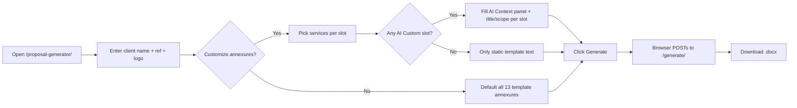
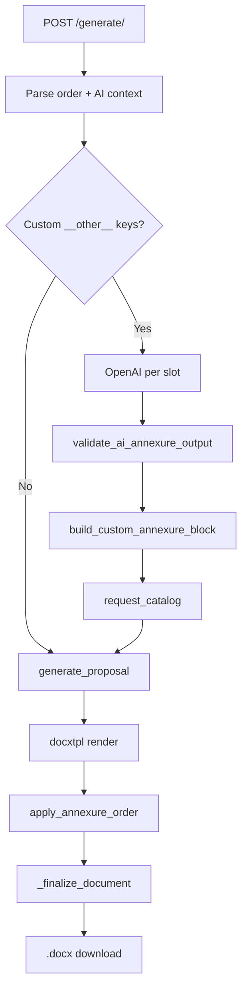

# CSS Proposal Generator — Handoff Guide

**Audience:** Someone new who will maintain or extend the feature  
**Tone:** Plain language + honest about gaps  
**Version referenced in code:** `1.4.0` (`css_proposal_generator.py`). Sections 1–13 describe the original v1.3.0 design; **sections 14–16 describe what v1.4.0 added (Excel-driven flow, formatting specification, verification)** and where it supersedes earlier statements.

---

## 1. What this feature is (30-second version)

The **Proposal Generator** builds a **Word proposal (`.docx`)** for CyberSmithSECURE sales/BD:

1. User fills a **web form** (client name, reference, optional logo).
2. User picks which **security assessments (annexures)** to include — usually from a **fixed list of 13** that already exist inside a Word template.
3. Optionally, user adds **“Other / Custom Service (AI-Generated)”** slots. For those, the server calls **OpenAI** to write annexure text, then **stamps it into the document** with the right fonts and colors.
4. The server returns **one downloadable `.docx`**: cover page, intro pages, chosen annexures (renumbered), table of contents, terms, and pricing — aligned to the org template.

It is **not** the same as **AI Layer** (`/ai-layer`), which fills Excel vulnerability rows. Same OpenAI key often, **different code and rules**.

---

## 2. Where it lives on the website

| What | URL (production pattern) |
|------|---------------------------|
| **Form (start here)** | `https://<your-railway-host>/proposal-generator/` |
| **Generate file** | `POST /proposal-generator/generate/` |
| **List of annexure types (JSON)** | `GET /proposal-generator/catalog/` |

**Common mistake:** `/proposal_generator` (underscore) → **wrong**. Use **`/proposal-generator`** (hyphen).

**Auth (updated):** The repo was cleaned up to contain only this feature. Azure SSO and the other VAPT tools were removed. Access is now protected by a simple login in `auth.py`:

- Browser: `/login` with the shared password `PROPOSAL_ACCESS_PASSWORD` (session cookie; 5 wrong tries per 5 minutes per IP, then blocked).
- Scripts: header `X-API-Key: <PROPOSAL_API_KEY>` (optional).
- Local dev only: `AUTH_DISABLED=true` skips login; `TEST_MODE=true` allows the cookie over plain http.

Everything under `/proposal-generator/*` requires one of these. `/health` and `/login` are public.

**Wiring:** Root app `Report-Generator-IP-main/app.py` **mounts** the proposal app:

```text
app.mount("/proposal-generator", proposal_generator_app)
```

---

## 3. Files that matter (full map)

### 3.1 Core feature (you will live in these)

| File | Role |
|------|------|
| **`Automation/backend/css_proposal_generator.py`** | **Everything important:** ~2,770 lines — FastAPI routes, HTML/JS UI, catalog, DOCX surgery, OpenAI calls, branding constants, CLI. **Monolith by design.** |
| **`Automation/backend/master_bd_prompt.txt`** | **Locked system prompt** for OpenAI (extracted from org “Master BD” doc). Loaded verbatim; do not “fix typos” in code — edit this file deliberately if BD approves. |
| **`Automation/backend/CSS_Proposal_Source.docx`** | Original Word template (source of truth for content/layout). |
| **`Automation/backend/CSS_Proposal_Base_Template.docx`** | Prepared template with `docxtpl` placeholders (`{{ client_name }}`, etc.). Auto-built from Source if missing. |
| **`Automation/backend/default_logo.png`** | Optional fallback if client logo not uploaded. |
| **`Automation/backend/tests/test_css_proposal_ai.py`** | Automated tests (parser, validation, mocked AI, TOC/logo/color regressions). |

**Note:** In some clones, the `.docx` files may not show up in search if they’re large or not committed — **deployment must have both Source and/or Base template** next to the Python file or generation fails at startup/generate time.

### 3.2 Platform glue (touch when deploying or securing)

| File | Role |
|------|------|
| **`Report-Generator-IP-main/app.py`** | Mounts proposal app at `/proposal-generator`. |
| **`Report-Generator-IP-main/auth.py`** | Login page, shared-password check, API-key check, login throttling. |
| **`Report-Generator-IP-main/reference/`** | Unzipped copy of the Word template (`_template_extract/`) plus `.zip`. Not used at runtime; kept as the readable source of annexure content. |
| **`Automation/backend/.env`** | `OPENAI_API_KEY`, optional `OPENAI_MODEL` (gitignored — set on Railway too). |
| **`Automation/backend/.env.example`** | Documents env vars (shared with AI Layer). |
| **`Report-Generator-IP-main/requirements.txt`** | `python-docx`, `docxtpl`, `openai`, FastAPI, etc. |

### 3.3 Runtime folders (created automatically)

| Path | Role |
|------|------|
| **`Automation/backend/uploads/css_proposal/`** | Copy of last generated file served to user (filename from sanitized client name). |

### 3.4 Removed from this repo (cleanup branch)

The VAPT report tools (`type1`–`type6`, `mitkat*`), AI Layer, Executive Summary, dashboard, database/AWS migration code, Azure SSO and the old tests were deleted. They still exist in git history: `git log --diff-filter=D --name-only` finds them, `git checkout <commit>~1 -- <path>` restores one.

There is **no** `css_proposal_ai_prompts.py` in the repo; prompts live in **`master_bd_prompt.txt`** + functions inside the big Python file.

---

## 4. Libraries & tools (what each one does)

| Library | Layman explanation |
|---------|-------------------|
| **FastAPI** | Web server: form, file upload, download response. |
| **docxtpl** | “Mail merge” for Word: fills client name, date, logo on the cover from a template. |
| **python-docx** | Opens Word files after merge; cut/paste annexure sections; build AI paragraphs; fix logos and TOC. |
| **openai** | Calls ChatGPT API (`AsyncOpenAI`) for custom annexure text only. |
| **pydantic** (if installed) | Validates JSON from the browser (`ai_context_json`). Falls back to dataclasses if missing. |
| **Pillow** | Optional — helps with logo image handling. |
| **uvicorn** | Runs the app (standalone CLI or via main `app.py`). |

**OpenAI settings (custom annexures):**

- Model: `OPENAI_MODEL` env or default **`gpt-4o`**
- `temperature=0.2` (somewhat deterministic, not zero)
- `max_tokens=3500`
- **Plain text** reply — **not** JSON mode

---

## 5. Logical flow — user side (layman steps)



**AI Context panel** (only if at least one slot is “Other / Custom Service”):

- Sector, engagement summary (short paragraph)
- Tier, counts (AD, cloud, apps, infra, users, **duration**)
- **Total cost**, taxes, **payment model** (milestone/hybrid/retainer/tier)
- Special constraints
- Per custom slot: **service title** + **scope** (min 20 characters in UI and server)

Browser runs **`validateAIContext()`** before submit (mirrors server rules).

---

## 6. Logical flow — server side (what happens on `POST /generate/`)

### Phase A — Parse form

1. **`company_name`**, **`proposal_ref`**, optional **`client_logo`**
2. **`annexure_order_json`** — which annexures, in order (catalog keys or `__other__<timestamp>_<random>`)
3. **`ai_context_json`** — only when custom AI slots exist
4. **`assessments_json`** — **legacy field; effectively unused today** (see §10)

### Phase B — AI (only if order contains `__other__...` keys)

1. Require **`ai_context_json`**; run **`_validate_ai_context`**
2. For **each** custom key (one after another, not parallel):
   - **`generate_custom_annexure_text()`**
     - System message = full **`master_bd_prompt.txt`**
     - User message = filled “Section A” + **hard rule: only this annexure, no T&C/payment/conclusion**
   - **`validate_ai_annexure_output()`** — must contain certain section titles + min 500 chars
   - **`build_custom_annexure_block()`** — turn plain text into Word XML with **Corbel**, purple headings `#7030A0`, bullets `•` / `o`
   - Register in **`request_catalog`** with prebuilt **`ai_elements`**

If AI fails → **HTTP error**, user retries manually. **No auto-retry loop.**

### Phase C — Build document (no LLM)

1. **`generate_proposal()`**
2. **`DocxTemplate.render`** → save temp docx (client name, ref, date, logo)
3. Post-process: replace placeholders, insert/fix **client logo** (left-aligned on cover)
4. **`apply_annexure_order()`**
   - **Static annexure:** copy pre-written block from template annexure N, renumber title “Annexure {slot}: {title}”
   - **Custom annexure:** insert prebuilt **`ai_elements`** + page break
   - Keep **Terms & Conditions** and **Conclusion & Pricing** from template (Annexure 13 tail) — **AI does not rewrite these**
5. **`_finalize_document()`** — refresh **Contents** page numbers; pricing table rows for selected services; TOC titles use **`request_catalog`** so you don’t see raw `__other__1780...` keys
6. Copy output to **`uploads/css_proposal/`** and return **`FileResponse`**



---

## 7. Two worlds: static annexures vs AI annexures

| | **Static (catalog keys like `web_app_pt`)** | **Custom AI (`__other__...`)** |
|--|---------------------------------------------|--------------------------------|
| **Text source** | Pre-written in **`CSS_Proposal_Base_Template.docx`** | **OpenAI** |
| **Legal / T&C / pricing** | From template | Still from template |
| **Formatting** | Original Word styles in template | **Python** rebuilds paragraphs (`_add_formatted_paragraph`) |
| **Risk** | Low — same text every time | Medium — model can sound plausible but invent scope/details |

**Catalog:** 13 built-in services (Post Breach, AD, Web PT, … Source Code Review). Defined in **`ASSESSMENT_CATALOG`** inside `css_proposal_generator.py`. Titles vs TOC labels can differ (historical template quirk).

---

## 8. Guardrails (how we keep format & content “on brand”)

Think of **four layers** (mix of all — not just “prompt only”):

1. **Template lock (strongest for structure)**  
   Cover, intro, standard annexures, T&C, conclusion/pricing come from the **Word file**, not the model.

2. **Prompt lock (content shape & tone)**  
   `master_bd_prompt.txt` + user message: CyberSmith voice, section order, bullets, tiers, “no fluff,” scope from user inputs. User message **forbids** generating T&C/payment even though the master file still *mentions* those sections for a full manual workflow.

3. **Code lock (visual brand)**  
   Hard-coded: Corbel, 16pt bold italic purple annexure titles, 14pt purple section labels, 11pt black body, bullet indents. Strips markdown `#` and `**`. Replaces `{{Client Name}}` tokens.

4. **Validation (lightweight)**  
   - **Before AI:** sector, summary length, duration, total cost, payment model, title/scope lengths.  
   - **After AI:** substring check for labels like `Sub-Activity:`, `Methodologies:`, … + minimum length.  
   - **Not checked:** whether counts/pricing in prose match the form; whether every sub-bullet from Master BD exists; factual truth of technical claims.

**Hallucination:** Reduced by low temperature and scope in the prompt — **not eliminated**. There is **no** RAG, **no** “don’t invent CVEs” rule (that’s AI Layer). **Human review of the DOCX** is still the real QA gate.

---

## 9. How to run & test (for developers)

**Integrated (same as Railway):**

```text
# From Report-Generator-IP-main — however you normally start the main FastAPI app
# Then open http://localhost:<port>/proposal-generator/
```

**Standalone (proposal only, port 8010):**

```text
cd Automation/backend
python css_proposal_generator.py
# Open http://localhost:8010/
```

**Rebuild base template** (after updating Source docx):

```text
python css_proposal_generator.py --build-template
```

**Tests:**

```text
cd Automation/backend
python -m pytest tests/test_css_proposal_ai.py -v
```

**Env:** Copy `.env.example` → `.env`; set **`OPENAI_API_KEY`**. On Railway, set the same variables in the dashboard (never commit `.env`).

---

## 10. Brutally honest: strengths, weaknesses, tech debt

### What was done well

- **End-to-end in one place** — form → AI → DOCX → download works without touching other report types.
- **Template-first** keeps legal/commercial sections stable.
- **Brand formatting for AI blocks** is coded, not left to the model.
- **Tests** cover parsers, validation, TOC regression, logo alignment, heading color.
- **Master prompt externalized** to `master_bd_prompt.txt` for BD-owned updates.

### What is fragile or incomplete

| Issue | Why it matters |
|-------|----------------|
| **~2,770-line single file** | Hard to navigate; UI, AI, and DOCX surgery are coupled. Refactors will hurt unless you split modules carefully. |
| **Public endpoint + OpenAI** | No rate limit on proposal AI (unlike AI Layer). Abuse or accidental loops cost money. |
| **No retry on bad AI output** | Missing section → user error; AI Layer retries automatically. |
| **Weak output validation** | Substring + length only; model can satisfy labels with thin content. |
| **Master prompt vs runtime mismatch** | File describes generating T&C/payment; code **forbids** that for API calls — confusing for new devs. |
| **`assessments_json` / `apply_assessments()`** | Parsed and passed into `generate_proposal()` but **`apply_assessments` is never called** — dead/legacy path. UI uses **`annexure_order_json` only**. |
| **Sequential AI calls** | Multiple custom slots = multiple API waits (20–40s each in UI copy). |
| **Body font 11pt for AI** vs possible 12pt in static annexures | Visual inconsistency possible between AI and template annexures. |
| **`.docx` assets may be missing in git** | Fresh clone can fail until someone adds Source/Base templates. |
| **No admin audit log** | Who generated what for which client is mostly server logs + files in `uploads/css_proposal/`. |
| **Semantic hallucination** | Prompt trust + human review; no automated fact-check against CRM/SOW. |

### Security notes (proportionate, not alarmist)

- OpenAI key lives server-side only (good).
- Public form means **validate file uploads** (logo) and monitor **upload size** — worth reviewing if you harden later.
- Generated proposals may contain **client names and commercial figures** in `uploads/` — treat disk as sensitive.

---

## 11. Glossary

| Term | Meaning |
|------|---------|
| **Annexure** | One major “service section” in the proposal (e.g. Web App PT). |
| **Catalog key** | Internal id like `web_app_pt` mapping to template annexure number 1–13. |
| **`__other__...` key** | Internal id for a **custom AI** slot; hidden from TOC when catalog is wired correctly. |
| **`request_catalog`** | Per-request copy of catalog + custom entries with `ai_elements`. |
| **docxtpl** | Word template engine for cover fields. |
| **OOXML** | Raw Word XML elements copied into the document body. |
| **Master BD prompt** | Org-approved instructions for how annexures should read. |

---

## 12. Checklist for someone continuing the build

1. Read **`css_proposal_generator.py`** top constants + **`ASSESSMENT_CATALOG`** + **`generate_proposal_endpoint`** + **`apply_annexure_order`** (custom branch).
2. Read **`master_bd_prompt.txt`** once as BD would.
3. Confirm **`CSS_Proposal_Base_Template.docx`** exists in deployed environment.
4. Set **`OPENAI_API_KEY`** on Railway; smoke-test **one static** and **one AI** annexure.
5. Run **`pytest tests/test_css_proposal_ai.py`** before any DOCX/AI change.
6. Do **not** copy AI Layer patterns blindly — proposal uses **plain text** and **lighter** validation unless you intentionally upgrade parity (retries, rate limits, JSON schema).

---

## 13. Suggested next improvements (prioritized)

1. Rate limit `/proposal-generator/generate/` (especially AI paths).
2. Retry OpenAI once when `validate_ai_annexure_output` fails, with a “fix missing sections” user message.
3. Split monolith: `proposal_routes.py`, `proposal_docx.py`, `proposal_ai.py`, `proposal_ui.html` template.
4. Remove or wire up **`assessments_json`** dead code.
5. Align Master BD file text with “annexure-only” API behavior.
6. Stronger validator: require `Frequency:`, `Count:`, annexure heading line match slot number.
7. ~~Optional SSO or API key for production AI generation.~~ Done: shared-password login + optional API key (`auth.py`).

---

---

## 14. v1.4.0 — Excel-driven flow (added after sections 1–13 were written)

### 14.1 What it does
A second way in: upload the filled **`CSS Pre-Engagement Scoping v2.xlsx`** at `/proposal-generator/excel/` (link on the manual form).

1. **Upload** (`POST /upload-excel/`, `.xlsx` ≤ 5 MB, rate-limited, never stored) is parsed by `proposal_excel.py`.
2. **Preview 1 – Annexures:** client name, editable reference number, include/exclude, **Count**, **Frequency**, order, manual toggles for the five annexures that have no Excel row (Insider Threat, SOC Simulation, Offensive & Defensive Training, Post Breach, Active Directory Assessment), an editable **proposal date** (printed on the cover), amber confirmation for a block that adds up to 0, AI context (sector, summary, duration, payment model) when an annexure has no template.
3. **Preview 2 – Conclusion & Pricing:** the exact table that goes into the Word file (Sr. No., Assessment Type, **Quantity**, Frequency, Cost Per Annexure). Prices are optional; rows can be removed or added.
4. **Build final document** (`POST /draft/{id}/build/`): builds the real file once (AI annexures, layout check, Contents numbers measured).
5. **Preview 3 – Final preview:** the PDF is shown in the page before anything is downloaded (summary: pages, layout engine, blank-page check). Then **Download Word (.docx, editable)** (`GET /draft/{id}/download/docx`) and **Download PDF** (`GET /draft/{id}/download/pdf`; `?inline=1` is what the preview frame uses). "Back to edit" returns to Preview 2; rebuilding reuses the stored AI text, so it costs nothing extra. Without a PDF engine the preview is replaced by a note and the Word download still works.
   API clients can still use `POST /draft/{id}/generate/` to get the `.docx` directly.

### 14.2 The two numbers (plan D30–D33)
For each annexure's block of matrix rows: **Count** = rows holding a number above 0 → the annexure's `Count: N <label>` line. **Quantity** = their sum → the pricing table. Example: SaaS rows 5, blank, blank, 4, 3 → Count 3 / Quantity 12; Web 2, 1, 4, 5, 3, 8 → Count 6 / Quantity 23. The mapping (cover cell, rows, labels, annexure number) lives in **`annexure_map.json`**: edit it, not the code.

### 14.3 New files
| File | Role |
|------|------|
| `proposal_excel.py` | Reads the workbook (Cover Page + Overall Scoping Matrix; other sheets only as AI context; contact details are never sent to the AI). Never raises: problems come back as `errors` / `warnings`. |
| `annexure_map.json` | Editable mapping and context sources. |
| `proposal_workflow.py` | Draft building, validated edits, readiness checks (what keeps Generate disabled), generation plan, and the router. |
| `proposal_excel_ui.html` | The upload + Preview 1 + Preview 2 page (builds DOM with `textContent`: no user text becomes markup). |
| `proposal_drafts.py` | 60-minute server-side drafts (random ids, expired files deleted, generated files kept only as long as the draft). |
| `proposal_ratelimit.py` | Per-IP sliding-window limits (`RATE_LIMIT_UPLOAD`, `RATE_LIMIT_GENERATE`). |
| `proposal_tokens.py` | **Every font, colour, size and table metric**, from the Formatting Specification. Change formatting here. |
| `proposal_fields.py` | Count/Frequency line rewriting, cross-reference renumbering. |
| `proposal_pricing.py` | Pricing table, Indian digit grouping (₹ 1,25,000), total rule. |
| `proposal_style.py` | **Track B:** applies the specification to the assembled document (section 15). |
| `proposal_lint.py` | Checks every output: numbering, Contents, blank pages, final section, package validity, tables within width, fonts/colours. |
| `proposal_pdf.py` | PDF render (LibreOffice or Word), blank-page detection, measured heading pages. |
| `../../css_scoping_testset/` | Generator of 137 dummy workbooks + expected results + `acceptance_run.py`. |

### 14.4 Behaviour worth knowing
- **Frequency is one shared field.** While it still holds the default `One Time`, each annexure keeps its own template wording (e.g. "One time with Revalidation"); once edited, the edited text is used in both the annexure and the pricing table.
- **External + Internal Network PT** appear as two pricing lines under one Annexure (1 in the master's numbering), with one combined Count line.
- **OpenAI key for the custom annexures:** set `PROPOSAL_OPENAI_API_KEY` (and optionally `PROPOSAL_OPENAI_MODEL`) in `Automation/backend/.env`. If empty, the shared `OPENAI_API_KEY` / `OPENAI_MODEL` are used.
- **AI annexures** receive the Excel context, one automatic retry if the structure check fails, and then a clear error (HTTP 502). The heading number and the Count line are always set by the system, never trusted from the model. The "Total cost" field is optional in this flow only (derived from the pricing table when every row is priced); the manual form still requires it.
- **Total row:** `₹ /- * + 18% GST` until *every* row is priced, then the sum (`₹ 1,75,000 /- * + 18% GST`). A partial sum is never shown.
- **Manual flow unchanged** except that it now gets the corrected layout and the new table styling; its pricing quantities are blank (the old dummy values such as "1 Web Application" were placeholders).

### 14.5 Defects found and fixed in the original generator
Found by rendering real output in Microsoft Word; all are covered by tests.
1. **Files Word refused to open** ("The file appears to be corrupted"): `docProps/core.xml` had `cp:lastModifiedBy`/`cp:revision` in the wrong XML namespace. Rewritten valid at the end of generation; the lint checks it.
2. **A company name with `&`, `<`, `>` or quotes** (e.g. "L&T", "Smith & Sons") corrupted the document (all 13 annexures instead of the selection, "&" vanishing from headings). docxtpl autoescape is now on.
3. **Blank pages** between sections and at the end (page-break paragraphs and trailing empty paragraphs spilling onto new pages). Page breaks are now `pageBreakBefore` properties; blank-paragraph spacing is gone.
4. **No closing section properties:** assembly deleted the template's final `sectPr`; Word fell back to defaults. A continuous closing section is restored.
5. **Wrong Contents numbers** (e.g. "Conclusion & Pricing … page 114"): `pageBreakBefore w:val="0"` was read as a break. Fixed, and the numbers are now **measured from a real render** when an engine exists.
6. **Contents listed three sections that do not exist** in the body ("Our Understanding of Your Requirement", "Methodology Overview", "Vulnerability Assessment Methodology"): removed.
7. **The first character of the cover reference was clipped** (`N-01-12-25`): a direct first-line indent doubled the style's indent. Fixed; long references are shrunk to fit.
8. **The pricing table was locked against editing** (a hidden `contentLocked` content control from the Google Docs export): Word refused any typing in it, so prices could not be filled in after downloading. Content controls are unwrapped; Word itself is tested typing into the table.

---

## 15. Formatting Specification compliance (Track B)

`proposal_style.apply_specification()` runs on every generated document. It applies `docs/CyberSmithSECURE_Proposal_Formatting_Specification.md`:

| Specification item | Result |
|---|---|
| Named styles (Heading 1/2/3, Annexure Title, TOC 1/2) | Defined from `proposal_tokens.py`; headings and sub-labels use them instead of direct formatting. |
| Body text | Corbel 11 pt, body colour `#595959`; bold/italic and purple/white emphasis kept. |
| No blank-paragraph spacing | Removed; spacing comes from paragraph spacing (6 pt after body, 3 pt in lists, 12 pt before headings, a gap after tables). |
| Real lists | Template lists were already real; AI annexures now use a real Word list definition (no typed bullets). |
| Tables (spec §9) | Team and deviation tables restyled: purple header row, repeating header, rows never split, grey borders, padding, within text width, "Sr No." never wraps. |
| Pricing table | Built from the tokens (5 columns, right-aligned Indian-format prices, merged Total row). |
| Signature block | Borderless two-column table (not space-aligned); a Date row is added as the specification lists it. |
| Automatic TOC | The Contents is a real Word `TOC` field (cached result = the measured lines); when Word updates fields it rebuilds from the headings (full annexure titles). |
| Pagination | No blank pages, no stacked breaks, headings keep-with-next, closing section present, Contents numbers measured. |

**Deliberately not changed (needs the brand owner) — recorded, not guessed:**
- **Cover page and Contents block** keep the template's own design: the exact `cover_navy` value and artwork are unconfirmed (`proposal_tokens.COVER_NAVY` is `None`).
- **Margins of the first sections** (1.0/0.75 cm sides) stay as the template's header artwork requires; the annexure sections already use 1 in (2.54 cm).
- **Body colour** `#595959` follows the source-verified value; the specification also allows `#404040` (one constant in `proposal_tokens.py`).
- **Header/footer artwork** is unchanged (image-based, page number present); a rebuilt header needs approved vector assets.
- **Signatory** (Smith Gonsalves, Chief Operating Officer) is the source value and still marked "confirm current signatory" by the specification.
- **Currency spacing in the deviation table** (`₹8,500 per hour` vs `₹ 8,500/hour`) awaits the approved format.

---

## 16. Verification status (honest summary)

| Check | Status |
|---|---|
| Test suite | **215 tests pass** (the first clean-virtualenv run gave 203; the rest were added since: key priority, final preview, AI cache, unlock/edit-in-Word) built only from `requirements.txt` (the original 55 regression tests are among them). Run from `Automation/backend`: `python -m pytest tests -q`. |
| Real layout in **Microsoft Word** | Verified here: every generated scenario opens in Word, has no blank pages, and its Contents numbers equal the measured pages; Word's own TOC update reproduces the same numbers. Tests that need an engine skip themselves when none is installed. |
| Dummy workbook acceptance | `python css_scoping_testset/acceptance_run.py --engine word` (see the result in the plan, section 17). |
| **LibreOffice on Railway** | **Not verified.** Configuration is in `nixpacks.toml`; LibreOffice could not be installed on the development machine, and pagination may differ slightly from Word (Corbel is a Microsoft font). Word remains the final authority. Without LibreOffice the app still works and reports `X-Proposal-Pdf: not verified`. |
| **Real OpenAI output** | **Verified locally with the real key** (`gpt-4.1`): 3 generations (2 in the Excel flow, 1 in the manual flow), about 5k tokens each, no retry needed; the annexures came back in the required structure, were numbered by position, passed the lint and rendered in Word with no blank pages. Retry/failure paths are covered with a fake client. Content accuracy still needs a human read: the model can add plausible specifics (e.g. an attempt count) that are not in the Excel. |
| **Deployment to Railway** | **Not performed.** Set `PROPOSAL_ACCESS_PASSWORD`, `SESSION_SECRET_KEY`, `OPENAI_API_KEY` and `TEST_MODE=false`; see `.env.example`. |
| A real filled client Excel | **Still needed.** Everything above was proven with generated dummy workbooks. |

---

## 17. v1.5.0 — the organisation's master document is the template

The template is now built from **`CyberSmithSECURE Annexures 2.docx`** (the document the organisation sends today). Sections 3, 14.5 and 15 describe the older template; where they disagree, this section wins.

### 17.1 What a generated proposal looks like
| Pages | Content | Source |
|---|---|---|
| 1 | Cover: date (top right), illustration, "Statement of Work & Proposal / For / client name" | master, fixed |
| 2 | "For", optional client logo, client name, **Contents** | master; Contents written by the generator |
| 3-8 | Introduction; Understanding + Team Overview; Methodology Overview; Vulnerability Assessment Methodology; the four phases; report contents + tools | master, **fixed** (same in every proposal) |
| 9 on | Annexures chosen by the Excel (numbered 1..N in the order shown on Preview 1), Terms & Conditions, Conclusion & Pricing + signatures | master annexure text; custom annexures written by AI |

Header (logo, "Statement of Work" tag) and footer (website, phone, email, purple band) are the master's, in **one section**, so every page has them. There is no "Proposed Timelines & Project Management" section any more.

### 17.2 How it is built
- **`build_source_template.py`** turns the master into `CSS_Proposal_Source.docx`: it appends the two annexures the master leaves out (**Post Breach Scenario Assessment** and **Active Directory Assessment**, taken from the previous source, as template annexures 12 and 13), unwraps the Contents control to a marker, ends the cover with a real page break, merges the split cover date, pins every fixed page start with `pageBreakBefore`, and puts a `{{ client_logo }}` slot on page 2. Inputs are the master and the previous source (`git show 104c35c:Automation/backend/CSS_Proposal_Source.docx`). Then `python css_proposal_generator.py --build-template` rewrites `CSS_Proposal_Base_Template.docx` (the file the app uses; it is tracked, commit it with the source).
- **Template annexure numbers** (`annexure_number` in `ASSESSMENT_CATALOG`, `annexure` in `annexure_map.json`, `TYPE_RULES` in the test-set generator) follow the master: Network PT 1, Web 2, Config Review 3, Insider Threat 4, Mobile 5, AD Security 6, SOC 7, Cloud 8, API 9, Training 10, Source Code Review 11, then Post Breach 12 and AD Assessment 13. A test checks the catalog against the Source template.
- **`proposal_contents.py`** writes the Contents as the master has it: a real `TOC` field, one hyperlinked line per heading with a `PAGEREF` and a `_Toc` bookmark on the heading. It lists exactly the headings in the body ("Annexure N: Title" in italics, then Terms & Conditions and Conclusion & Pricing). Page numbers are an estimate first and then the numbers measured from a real render. The old line-by-line Contents helpers are gone.
- **Pages 3-8 are frozen**: `proposal_style.apply_specification` leaves their text, fonts and diagram spacing as the master has them (the master *is* the source of the specification). Only their table (Team Overview) is brought to the table standard, compactly so it stays on page 4. Blank-line spacing inside those pages is not linted.
- **Cover**: `{{ proposal_date }}` (DD-MM-YYYY) replaces the master's date; the client name is centred as in the master. The reference number is still collected (Excel cell F16) but **not printed**; the date is. Manual form: its "reference" field is the cover date.
- **Client logo**: only an uploaded logo is placed between "For" and the client name. With none, the master's empty slot stays (no CyberSmithSECURE logo is substituted).
- Page 6 keeps the "involves the following phases as identified below:" line on page 6 (the master pushed it to the page bottom with a dozen empty paragraphs, which only fits with its exact metrics).
- The Conclusion table's first column has a minimum width so "Total" and "Sr. No." never break mid-word; "In witness whereof" is kept with the signature table.

### 17.3 Verified here (Windows, Microsoft Word as the layout engine)
- 231 tests pass (the original 55 regression tests were kept; the ones that pinned the old template were updated).
- A rendered proposal has eight fixed pages, the Introduction on page 3 and Annexure 1 on page 9; no blank pages; Contents numbers equal the measured pages; Word's own TOC update and an edit in the pricing table work.
- Acceptance run over the dummy workbooks and the jsdom UI test (known-only build, Word + PDF downloads) pass.
- **Not verified:** LibreOffice on Railway (no Corbel font there: the fixed pages may paginate differently from Word), a real filled client Excel, and the brand-owner items in section 15.

*Last updated: handoff aligned to codebase v1.5.0.*
