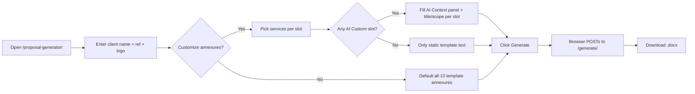
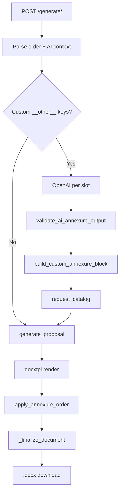

# CSS Proposal Generator — Handoff Guide

**Audience:** Someone new who will maintain or extend the feature  
**Tone:** Plain language + honest about gaps  
**Version referenced in code:** `1.3.0` (`css_proposal_generator.py`)

---

## 1. What this feature is (30-second version)

The **Proposal Generator** builds a **Word proposal (`.docx`)** for CyberSmithSECURE sales/BD:

1. User fills a **web form** (client name, reference, optional logo).
2. User picks which **security assessments (annexures)** to include — usually from a **fixed list of 13** that already exist inside a Word template.
3. Optionally, user adds **“Other / Custom Service (AI-Generated)”** slots. For those, the server calls **OpenAI** to write annexure text, then **stamps it into the document** with the right fonts and colors.
4. The server returns **one downloadable `.docx`**: cover page, intro pages, chosen annexures (renumbered), table of contents, terms, and pricing — aligned to the org template.

It is **not** the same as **AI Layer** (`/ai-layer`), which fills Excel vulnerability rows. Same OpenAI key often, **different code and rules**.

---

## 2. Where it lives on the website

| What | URL (production pattern) |
|------|---------------------------|
| **Form (start here)** | `https://<your-railway-host>/proposal-generator/` |
| **Generate file** | `POST /proposal-generator/generate/` |
| **List of annexure types (JSON)** | `GET /proposal-generator/catalog/` |

**Common mistake:** `/proposal_generator` (underscore) → **wrong**. Use **`/proposal-generator`** (hyphen).

**Auth:** `/proposal-generator/` is treated as a **public path** in `session_security.py` (no Azure SSO). That helps BD use it quickly, but it also means **anyone with the URL can hit the form and burn OpenAI credits** if AI slots are used.

**Wiring:** Root app `Report-Generator-IP-main/app.py` **mounts** the proposal app:

```text
app.mount("/proposal-generator", proposal_generator_app)
```

---

## 3. Files that matter (full map)

### 3.1 Core feature (you will live in these)

| File | Role |
|------|------|
| **`Automation/backend/css_proposal_generator.py`** | **Everything important:** ~2,770 lines — FastAPI routes, HTML/JS UI, catalog, DOCX surgery, OpenAI calls, branding constants, CLI. **Monolith by design.** |
| **`Automation/backend/master_bd_prompt.txt`** | **Locked system prompt** for OpenAI (extracted from org “Master BD” doc). Loaded verbatim; do not “fix typos” in code — edit this file deliberately if BD approves. |
| **`Automation/backend/CSS_Proposal_Source.docx`** | Original Word template (source of truth for content/layout). |
| **`Automation/backend/CSS_Proposal_Base_Template.docx`** | Prepared template with `docxtpl` placeholders (`{{ client_name }}`, etc.). Auto-built from Source if missing. |
| **`Automation/backend/default_logo.png`** | Optional fallback if client logo not uploaded. |
| **`Automation/backend/tests/test_css_proposal_ai.py`** | Automated tests (parser, validation, mocked AI, TOC/logo/color regressions). |

**Note:** In some clones, the `.docx` files may not show up in search if they’re large or not committed — **deployment must have both Source and/or Base template** next to the Python file or generation fails at startup/generate time.

### 3.2 Platform glue (touch when deploying or securing)

| File | Role |
|------|------|
| **`Report-Generator-IP-main/app.py`** | Mounts proposal app at `/proposal-generator`. |
| **`Report-Generator-IP-main/session_security.py`** | Lists `/proposal-generator/` as public (SSO bypass). |
| **`Automation/backend/.env`** | `OPENAI_API_KEY`, optional `OPENAI_MODEL` (gitignored — set on Railway too). |
| **`Automation/backend/.env.example`** | Documents env vars (shared with AI Layer). |
| **`Report-Generator-IP-main/requirements.txt`** | `python-docx`, `docxtpl`, `openai`, FastAPI, etc. |

### 3.3 Runtime folders (created automatically)

| Path | Role |
|------|------|
| **`Automation/backend/uploads/css_proposal/`** | Copy of last generated file served to user (filename from sanitized client name). |

### 3.4 **Not** part of proposal generator (do not confuse)

| File | Why it’s unrelated |
|------|---------------------|
| `ai_layer.py`, `ai_prompts.py` | Excel row narratives, JSON output, stricter anti-hallucination, rate limits, retries. |
| `exec_summary.py` | Executive summary Word feature; **not mounted** in `app.py` unless someone adds it. |
| `type1`–`type6`, `mitkat*` | VAPT report automation — different products. |

There is **no** `css_proposal_ai_prompts.py` in the repo; prompts live in **`master_bd_prompt.txt`** + functions inside the big Python file.

---

## 4. Libraries & tools (what each one does)

| Library | Layman explanation |
|---------|-------------------|
| **FastAPI** | Web server: form, file upload, download response. |
| **docxtpl** | “Mail merge” for Word: fills client name, date, logo on the cover from a template. |
| **python-docx** | Opens Word files after merge; cut/paste annexure sections; build AI paragraphs; fix logos and TOC. |
| **openai** | Calls ChatGPT API (`AsyncOpenAI`) for custom annexure text only. |
| **pydantic** (if installed) | Validates JSON from the browser (`ai_context_json`). Falls back to dataclasses if missing. |
| **Pillow** | Optional — helps with logo image handling. |
| **uvicorn** | Runs the app (standalone CLI or via main `app.py`). |

**OpenAI settings (custom annexures):**

- Model: `OPENAI_MODEL` env or default **`gpt-4o`**
- `temperature=0.2` (somewhat deterministic, not zero)
- `max_tokens=3500`
- **Plain text** reply — **not** JSON mode

---

## 5. Logical flow — user side (layman steps)



**AI Context panel** (only if at least one slot is “Other / Custom Service”):

- Sector, engagement summary (short paragraph)
- Tier, counts (AD, cloud, apps, infra, users, **duration**)
- **Total cost**, taxes, **payment model** (milestone/hybrid/retainer/tier)
- Special constraints
- Per custom slot: **service title** + **scope** (min 20 characters in UI and server)

Browser runs **`validateAIContext()`** before submit (mirrors server rules).

---

## 6. Logical flow — server side (what happens on `POST /generate/`)

### Phase A — Parse form

1. **`company_name`**, **`proposal_ref`**, optional **`client_logo`**
2. **`annexure_order_json`** — which annexures, in order (catalog keys or `__other__<timestamp>_<random>`)
3. **`ai_context_json`** — only when custom AI slots exist
4. **`assessments_json`** — **legacy field; effectively unused today** (see §10)

### Phase B — AI (only if order contains `__other__...` keys)

1. Require **`ai_context_json`**; run **`_validate_ai_context`**
2. For **each** custom key (one after another, not parallel):
   - **`generate_custom_annexure_text()`**
     - System message = full **`master_bd_prompt.txt`**
     - User message = filled “Section A” + **hard rule: only this annexure, no T&C/payment/conclusion**
   - **`validate_ai_annexure_output()`** — must contain certain section titles + min 500 chars
   - **`build_custom_annexure_block()`** — turn plain text into Word XML with **Corbel**, purple headings `#7030A0`, bullets `•` / `o`
   - Register in **`request_catalog`** with prebuilt **`ai_elements`**

If AI fails → **HTTP error**, user retries manually. **No auto-retry loop.**

### Phase C — Build document (no LLM)

1. **`generate_proposal()`**
2. **`DocxTemplate.render`** → save temp docx (client name, ref, date, logo)
3. Post-process: replace placeholders, insert/fix **client logo** (left-aligned on cover)
4. **`apply_annexure_order()`**
   - **Static annexure:** copy pre-written block from template annexure N, renumber title “Annexure {slot}: {title}”
   - **Custom annexure:** insert prebuilt **`ai_elements`** + page break
   - Keep **Terms & Conditions** and **Conclusion & Pricing** from template (Annexure 13 tail) — **AI does not rewrite these**
5. **`_finalize_document()`** — refresh **Contents** page numbers; pricing table rows for selected services; TOC titles use **`request_catalog`** so you don’t see raw `__other__1780...` keys
6. Copy output to **`uploads/css_proposal/`** and return **`FileResponse`**



---

## 7. Two worlds: static annexures vs AI annexures

| | **Static (catalog keys like `web_app_pt`)** | **Custom AI (`__other__...`)** |
|--|---------------------------------------------|--------------------------------|
| **Text source** | Pre-written in **`CSS_Proposal_Base_Template.docx`** | **OpenAI** |
| **Legal / T&C / pricing** | From template | Still from template |
| **Formatting** | Original Word styles in template | **Python** rebuilds paragraphs (`_add_formatted_paragraph`) |
| **Risk** | Low — same text every time | Medium — model can sound plausible but invent scope/details |

**Catalog:** 13 built-in services (Post Breach, AD, Web PT, … Source Code Review). Defined in **`ASSESSMENT_CATALOG`** inside `css_proposal_generator.py`. Titles vs TOC labels can differ (historical template quirk).

---

## 8. Guardrails (how we keep format & content “on brand”)

Think of **four layers** (mix of all — not just “prompt only”):

1. **Template lock (strongest for structure)**  
   Cover, intro, standard annexures, T&C, conclusion/pricing come from the **Word file**, not the model.

2. **Prompt lock (content shape & tone)**  
   `master_bd_prompt.txt` + user message: CyberSmith voice, section order, bullets, tiers, “no fluff,” scope from user inputs. User message **forbids** generating T&C/payment even though the master file still *mentions* those sections for a full manual workflow.

3. **Code lock (visual brand)**  
   Hard-coded: Corbel, 16pt bold italic purple annexure titles, 14pt purple section labels, 11pt black body, bullet indents. Strips markdown `#` and `**`. Replaces `{{Client Name}}` tokens.

4. **Validation (lightweight)**  
   - **Before AI:** sector, summary length, duration, total cost, payment model, title/scope lengths.  
   - **After AI:** substring check for labels like `Sub-Activity:`, `Methodologies:`, … + minimum length.  
   - **Not checked:** whether counts/pricing in prose match the form; whether every sub-bullet from Master BD exists; factual truth of technical claims.

**Hallucination:** Reduced by low temperature and scope in the prompt — **not eliminated**. There is **no** RAG, **no** “don’t invent CVEs” rule (that’s AI Layer). **Human review of the DOCX** is still the real QA gate.

---

## 9. How to run & test (for developers)

**Integrated (same as Railway):**

```text
# From Report-Generator-IP-main — however you normally start the main FastAPI app
# Then open http://localhost:<port>/proposal-generator/
```

**Standalone (proposal only, port 8010):**

```text
cd Automation/backend
python css_proposal_generator.py
# Open http://localhost:8010/
```

**Rebuild base template** (after updating Source docx):

```text
python css_proposal_generator.py --build-template
```

**Tests:**

```text
cd Automation/backend
python -m pytest tests/test_css_proposal_ai.py -v
```

**Env:** Copy `.env.example` → `.env`; set **`OPENAI_API_KEY`**. On Railway, set the same variables in the dashboard (never commit `.env`).

---

## 10. Brutally honest: strengths, weaknesses, tech debt

### What was done well

- **End-to-end in one place** — form → AI → DOCX → download works without touching other report types.
- **Template-first** keeps legal/commercial sections stable.
- **Brand formatting for AI blocks** is coded, not left to the model.
- **Tests** cover parsers, validation, TOC regression, logo alignment, heading color.
- **Master prompt externalized** to `master_bd_prompt.txt` for BD-owned updates.

### What is fragile or incomplete

| Issue | Why it matters |
|-------|----------------|
| **~2,770-line single file** | Hard to navigate; UI, AI, and DOCX surgery are coupled. Refactors will hurt unless you split modules carefully. |
| **Public endpoint + OpenAI** | No rate limit on proposal AI (unlike AI Layer). Abuse or accidental loops cost money. |
| **No retry on bad AI output** | Missing section → user error; AI Layer retries automatically. |
| **Weak output validation** | Substring + length only; model can satisfy labels with thin content. |
| **Master prompt vs runtime mismatch** | File describes generating T&C/payment; code **forbids** that for API calls — confusing for new devs. |
| **`assessments_json` / `apply_assessments()`** | Parsed and passed into `generate_proposal()` but **`apply_assessments` is never called** — dead/legacy path. UI uses **`annexure_order_json` only**. |
| **Sequential AI calls** | Multiple custom slots = multiple API waits (20–40s each in UI copy). |
| **Body font 11pt for AI** vs possible 12pt in static annexures | Visual inconsistency possible between AI and template annexures. |
| **`.docx` assets may be missing in git** | Fresh clone can fail until someone adds Source/Base templates. |
| **No admin audit log** | Who generated what for which client is mostly server logs + files in `uploads/css_proposal/`. |
| **Semantic hallucination** | Prompt trust + human review; no automated fact-check against CRM/SOW. |

### Security notes (proportionate, not alarmist)

- OpenAI key lives server-side only (good).
- Public form means **validate file uploads** (logo) and monitor **upload size** — worth reviewing if you harden later.
- Generated proposals may contain **client names and commercial figures** in `uploads/` — treat disk as sensitive.

---

## 11. Glossary

| Term | Meaning |
|------|---------|
| **Annexure** | One major “service section” in the proposal (e.g. Web App PT). |
| **Catalog key** | Internal id like `web_app_pt` mapping to template annexure number 1–13. |
| **`__other__...` key** | Internal id for a **custom AI** slot; hidden from TOC when catalog is wired correctly. |
| **`request_catalog`** | Per-request copy of catalog + custom entries with `ai_elements`. |
| **docxtpl** | Word template engine for cover fields. |
| **OOXML** | Raw Word XML elements copied into the document body. |
| **Master BD prompt** | Org-approved instructions for how annexures should read. |

---

## 12. Checklist for someone continuing the build

1. Read **`css_proposal_generator.py`** top constants + **`ASSESSMENT_CATALOG`** + **`generate_proposal_endpoint`** + **`apply_annexure_order`** (custom branch).
2. Read **`master_bd_prompt.txt`** once as BD would.
3. Confirm **`CSS_Proposal_Base_Template.docx`** exists in deployed environment.
4. Set **`OPENAI_API_KEY`** on Railway; smoke-test **one static** and **one AI** annexure.
5. Run **`pytest tests/test_css_proposal_ai.py`** before any DOCX/AI change.
6. Do **not** copy AI Layer patterns blindly — proposal uses **plain text** and **lighter** validation unless you intentionally upgrade parity (retries, rate limits, JSON schema).

---

## 13. Suggested next improvements (prioritized)

1. Rate limit `/proposal-generator/generate/` (especially AI paths).
2. Retry OpenAI once when `validate_ai_annexure_output` fails, with a “fix missing sections” user message.
3. Split monolith: `proposal_routes.py`, `proposal_docx.py`, `proposal_ai.py`, `proposal_ui.html` template.
4. Remove or wire up **`assessments_json`** dead code.
5. Align Master BD file text with “annexure-only” API behavior.
6. Stronger validator: require `Frequency:`, `Count:`, annexure heading line match slot number.
7. Optional SSO or API key for production AI generation.

---

*Last updated: handoff doc aligned to codebase v1.3.0 (`css_proposal_generator.py`).*
